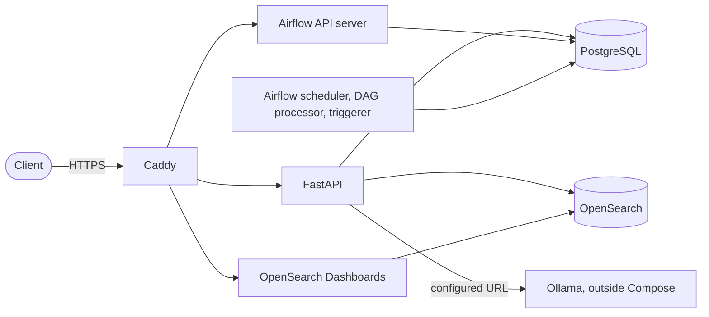

# arXiv Paper Curator

A research assistant that collects academic papers from arXiv and answers research questions about them. See [GLOSSARY.md](GLOSSARY.md) for the project's language.

This repository currently holds the **infrastructure foundation**: the running platform that later capabilities, starting with Paper ingestion, are built on. It exposes health endpoints only.

## What "production-ready" means here

Production mode is a hardened stack that really runs and is tested by automation. It has never been deployed and has never served real traffic, because the project has no hosting budget and no users ([ADR 0001](docs/adr/0001-production-ready-without-deploying.md)). So the claim is **production-ready, not production-proven**. The [runbook](docs/runbook.md) lists the remaining work, and which of its steps are untested.

Known limits:

- Nothing has run under load, or on more than one node.
- PostgreSQL and OpenSearch are single instances, so there is no high availability.
- The API has no authentication or rate limiting yet. They arrive with its first endpoint other than health.
- Logs are JSON once services are running. First-start output, JVM warnings and the Airflow scheduler's health check access lines are still plain text.
- The internal OpenSearch certificates live for about two years and do not renew themselves.

## Architecture



- **PostgreSQL** is the source of truth and the only data store with backups. The application and Airflow each have their own database and user, and neither can connect to the other's database.
- **OpenSearch** indexes are rebuildable. From Paper ingestion onward, everything indexed must be recoverable from PostgreSQL or arXiv.
- **Ollama** runs natively on the host in every mode, so inference uses the Apple GPU. The API only knows it through `OLLAMA__URL`.
- **Alembic** owns the schema. Migrations run as a separate step before the API starts.
- **Airflow** uses `LocalExecutor`, with each component in its own service.

The code is the `paper_curator` package in `src/`, organised by capability.

### Health contract

| Endpoint | Situation | HTTP status | Body status |
|---|---|---|---|
| `GET /api/v1/health/live` | API process responding | 200 | `ok` |
| `GET /api/v1/health` | All dependencies up | 200 | `ok` |
| `GET /api/v1/health` | Only Ollama down | 200 | `degraded` |
| `GET /api/v1/health` | PostgreSQL or OpenSearch down | 503 | `unhealthy` |

Responses contain status names only, with no versions or hostnames.

## The two modes

`compose.yaml` defines development mode, and `compose.prod.yaml` holds every difference from it.

| | Development mode | Production mode |
|---|---|---|
| Entry point | Each service on a loopback port | Caddy with HTTPS on ports 80 and 443 |
| Credentials | Throwaway values in `.env` | Generated files, passed as Compose secrets |
| OpenSearch | No security | TLS and authentication |
| API | Hot reload | Read-only filesystem, JSON logs |
| Containers | Image defaults | Non-root, resource limits, restart policies |

Each mode has its own Compose project, so they do not share data.

## Setup on a Mac

```sh
brew install colima docker docker-compose uv ollama
mkdir -p ~/.docker/cli-plugins
ln -sfn "$(brew --prefix)/opt/docker-compose/bin/docker-compose" ~/.docker/cli-plugins/docker-compose
colima start --cpu 6 --memory 12
```

## Run development mode

```sh
cp .env.example .env
docker compose up
```

| Service | Address | Login |
|---|---|---|
| API | http://127.0.0.1:8000/api/v1/health | None |
| Airflow | http://127.0.0.1:8080 | `admin`, password in `.env` |
| OpenSearch | http://127.0.0.1:9200 | None |
| OpenSearch Dashboards | http://127.0.0.1:5601 | None |
| PostgreSQL | 127.0.0.1:5432 | Passwords in `.env` |

## Run production mode

```sh
make prod
```

This generates any missing secret in `secrets/`, which git ignores, and starts the stack.

| Service | Address | Login |
|---|---|---|
| API | https://localhost/api/v1/health | None |
| Airflow | https://airflow.localhost | `admin`, password in `secrets/airflow_admin_password` |
| OpenSearch Dashboards | https://opensearch.localhost | `admin`, password in `secrets/opensearch_admin_password` |

Certificates come from Caddy's internal certificate authority, so browsers warn about them unless you trust its root. To get a copy of the root:

```sh
COMPOSE_FILE=compose.yaml:compose.prod.yaml docker compose cp \
  caddy:/data/caddy/pki/authorities/local/root.crt .
```

## Tests and checks

| Command | What it does |
|---|---|
| `make check` | Formatting, lint, types, and the tests that need no running stack |
| `make smoke` | End-to-end tests against a running development mode |
| `make prod-smoke` | End-to-end tests against a running production mode, through Caddy |
| `make format` | Formats the code and applies safe lint fixes |

Tests check behaviour through the HTTP contract of the API and of the running stack. The end-to-end tests also run the trivial DAG through Airflow's API, and back up, restore and confirm data.

CI runs the checks, a secret scan, the `amd64` image builds and both smoke tests on every PR. It uses a fake Ollama (`tests/fake_ollama.py`), so a real model is only exercised on a Mac.

## Backups

```sh
make prod-backup                                # Writes to backups/<timestamp>/
make prod-restore BACKUP=backups/<timestamp>    # Stops writers, restores, starts them again
```

`make backup` and `make restore` do the same for development mode.

## Findings from building this

- Containers reach an Ollama that listens only on `127.0.0.1` through `host.docker.internal` under Colima, so Ollama needs no exposure to the network. On Linux it does not work this way, and the runbook covers it.
- Colima's 12 GB is enough. Production mode uses about 3 GB when idle.
- OpenSearch needed no memory changes under Colima beyond a 1 GB heap.
- PostgreSQL 18 is the newest stable major. PostgreSQL 19 is still a release candidate.

## Licence

[MIT](LICENSE)
